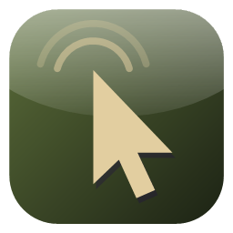

<p align="center"></p>

<h1 align="center">Wardogs AutoClicker 4.20</h1>

<p align="center">Team joiner, party sync, auto-run and auto-revive for <b>WARDOGS</b> on Windows 10 and 11.</p>

## What it's for

This tool is only for **ease-of-use features** and a **party system to play with friends**.

- **The auto clicker only runs while you're selecting a team.** It clicks your faction's card on the SELECT FACTION screen and refuses to click anywhere else. If that screen isn't showing, it does nothing, and it stops as soon as the screen closes.
- Nothing in it aims, shoots, or gives you information other players don't have. It never reads or changes the game's memory or files.

> [!WARNING]
> WARDOGS' EULA bans tools that simulate or replace human input (§14.1(b)) and the distribution of automation software (§5.2(r)). Using this app can get your account suspended or banned. Use it at your own risk. This is an unofficial fan project, not affiliated with Bulkhead or Team17.

## Download

**[⬇ Download AutoClicker4dot20.exe](https://github.com/z0157/wardogs-autoclicker/releases/latest/download/AutoClicker4dot20.exe)**

One file for Windows 10 and Windows 11 (64-bit). No installer needed.

## Setup

1. Download `AutoClicker4dot20.exe` and put it somewhere handy, like your Desktop.
2. Double-click it. The app isn't code-signed, so Windows SmartScreen may say *"Windows protected your PC"*. Click **More info → Run anyway**.
3. Start WARDOGS. The app finds the game by itself.
4. **Windows 10 only:** if a message says the app needs **Microsoft Edge WebView2**, click **Yes**, install Microsoft's *Evergreen Bootstrapper*, then open the app again. (Windows 11 already has it.)

That's it. Your settings are saved in `%APPDATA%\AutoClicker4dot20\`, so you can move or update the exe freely.

## Using it

**Join a team.** Pick Lonestar, Valkyra or Manticore in the app. On the in-game **SELECT FACTION** screen, press **F6**. It clicks that team's card 10 times a second until you're in, then stops by itself. It also stops if you move the mouse, press F6 again, leave the game, or after 10 minutes. It only clicks while the faction screen is showing, never during a match. Card positions are built in and work at any resolution.

**Join as a group.** Open **Party → Create party** and send the code to your friends; they type it in and press **Join**. The leader picks the team and presses JOIN, and everyone's app joins the same team as soon as their faction screen is open. Leadership can be handed to anyone with **Make leader**, and passes on automatically if the leader leaves. Your Steam name is used by default.

**Auto-run.** **F7** holds **W + Left Shift** so you sprint forward hands-free. It stops when you press F7 again, tap W or S, leave the game, or start a revive.

**Auto-revive.** **F5** holds **F** for 22 seconds (a bare-hands revive takes about 20). Press F5 again to cancel; moving or leaving the game also stops it. Use **− / +** on its row to change the time.

### Default keys

| Key | Action |
| --- | --- |
| F6 | Join the selected team (start / stop) |
| F8 / F9 / F10 | Join Lonestar / Valkyra / Manticore |
| F7 | Auto-run on / off |
| F5 | Auto-revive (start / cancel) |
| W, S, Left Shift, F | Forward, stop, sprint and revive keys the app uses |
| Enter | Save a JOIN spot while setting one up |

Every key can be changed in the **Keys** list: click it, then press the new key. Combos like Ctrl + F6 and mouse side buttons work. Keys only respond while WARDOGS or the app is in front.

## How it works

- **Screen:** it looks at the middle of the screen (like a screenshot) to check the SELECT FACTION panel is open, by its shape and the faction colours. It never reads or changes the game's memory or files.
- **Input:** clicks and key presses go through the standard Windows input API.
- **Party sync:** messages go through [ntfy.sh](https://ntfy.sh), a free public relay, on a topic derived from the party code. Only display names, the team pick and JOIN spots are sent, and anyone who knows the code can see them.
- **Log:** each join attempt is logged to `%APPDATA%\AutoClicker4dot20\join-log.txt`, which helps when something goes wrong.

## Build from source

Requirements: Windows, [Rust](https://rustup.rs) (stable, MSVC toolchain) and the Visual Studio C++ Build Tools.

```bash
cargo build --release
```

The app is written to `target\release\autoclicker4dot20.exe`. It's a [Tauri 2](https://tauri.app) app: Rust in `src/` (input, hooks, team join, party sync) and the interface in `ui/` (plain HTML, CSS and JavaScript).
